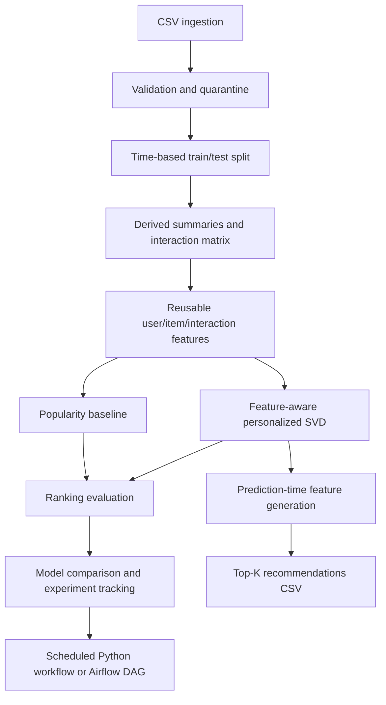

# End-to-End Data Management Pipeline for a Movie Recommendation System

A modular implementation of all eight assignment stages using reproducible synthetic movie data. The dataset contains 200 users, 80 movies and 5,000 valid interactions; six deliberately invalid interactions are included to demonstrate quarantine and validation reporting.

## Architecture



## Project layout

- `data/raw`: synthetic user, movie and rating CSV files.
- `data/processed`: validated metadata, chronological train/test sets, activity summaries, popularity and interaction matrix.
- `data/errors`: issue-level invalid record quarantine and validation report.
- `data/features`: reusable user, item and interaction feature tables plus feature catalog.
- `src`: modular ingestion, validation, preparation, transformation, features, training, evaluation and tracking.
- `pipeline_tasks.py`, `run_stage.py`, `run_pipeline.py`: independently rerunnable stages and end-to-end runner.
- `recommend.py`: prediction-time feature generation and top-K inference example.
- `dags/recommendation_pipeline_dag.py`: eight-task Airflow DAG.
- `docker-compose.airflow.yaml`, `Dockerfile.airflow`: reproducible local Airflow environment.
- `tests`: unit and integration tests.

## Setup and end-to-end execution

Python 3.10+ is recommended.

```bash
python -m venv .venv
source .venv/bin/activate       # Windows: .venv\\Scripts\\activate
pip install -r requirements.txt
python run_pipeline.py
pytest -q
```

Run one stage independently, for example `python run_stage.py validate`. The stages are `ingest`, `validate`, `prepare`, `transform`, `features`, `train`, `evaluate`, and `track`.

## Prediction / inference example

After running the pipeline, generate recommendations for a user:

```bash
python recommend.py --user-id 1 --k 5 --model svd
```

The command creates `reports/sample_recommendations.csv`. It rebuilds inference-time user and item features from historical training interactions using the same feature-generation functions as training, then supplies those features to the personalized recommender. The history argument must contain only events available at the prediction cutoff to avoid leakage.

## Data validation and preparation

Validation checks required fields, missing/non-numeric values, duplicate metadata keys and interactions, positive integer identifiers, age/release-year ranges, rating range 1–5, timestamp validity and referential integrity. Invalid records are written to `data/errors/invalid_records.csv`; summary counts are in `data/errors/validation_report.csv`.

The chronological split uses the configured 80/20 fraction. The raw data remains unchanged. Derived tables include user activity, item popularity and a user-item interaction matrix.

## Feature management

The feature layer writes user, item and interaction features and a table-format feature catalog. User features include average rating, activity count, last interaction, days since last interaction, preferred genre, age and region. Item features include popularity, average rating, genre and release year. Interaction features include rating, event timestamp and age relative to a reference time.

The same `_feature_tables` calculation is called by training feature generation and `build_inference_features`. The SVD model is trained with and persists the engineered user/item feature maps. At inference, request-scoped features are passed into its recommendation method. The personalized model blends collaborative filtering, preferred-genre affinity and popularity, then applies a genre-aware re-ranking step.

## Models and evaluation

1. Popularity baseline: ranks movies by historical interaction count.
2. Feature-aware personalized SVD: matrix factorization on the explicit-rating matrix, combined with user/item features at ranking time.

Evaluation uses K=5 and ratings >=4 as relevant. Both models are compared on Precision@5, Recall@5, NDCG@5, catalog Coverage and genre-based Diversity. The personalized rating predictions also report RMSE and MAE. See `reports/model_comparison.csv`.

## Experiment tracking

`reports/experiment_tracking.json` is the portable local experiment tracker: it records a unique run ID, run time, configuration parameters, per-model metrics, artifact paths, sizes and SHA-256 checksums for model, report and feature artifacts. The code also supports MLflow when installed and configured (`MLFLOW_TRACKING_URI` may point to a tracking server). Install MLflow from `requirements.txt` to enable parameter, metric, model and report artifact logging. If MLflow is unavailable, local JSON tracking remains functional and the status is recorded honestly in the JSON file.

## Orchestration

### Scheduled Python workflow (portable)

The ordered runner has explicit stage dependencies and exits on failure. To schedule it daily at 02:00 using cron:

```cron
0 2 * * * cd /path/to/recommendation-pipeline && /path/to/recommendation-pipeline/.venv/bin/python run_pipeline.py >> /path/to/recommendation-pipeline/logs/scheduled_pipeline.log 2>&1
```

Or use `scripts/run_scheduled.sh` after creating `.venv`.

### Apache Airflow (local Docker)

Docker and Docker Compose are required. From the project root:

```bash
docker compose -f docker-compose.airflow.yaml up --build airflow
```

Open `http://localhost:8080`, use the admin credentials printed in the container startup logs, enable `movie_recommendation_end_to_end`, and trigger it. The DAG contains eight separate tasks with explicit dependencies and retry settings. After all tasks succeed, capture the actual Airflow Graph/Grid view and save it as `reports/airflow_successful_run.png`. No screenshot is included unless it is captured from a real run.

## Verification performed in this build

- `python run_pipeline.py`: passed all eight stages.
- `pytest -q`: 8 tests passed, including validation, shared training/inference features, ranking metric correctness, feature-aware model use and end-to-end recommendation generation.
- `python -m compileall -q .`: passed.
- `python recommend.py --user-id 1 --k 5`: generated five recommendations.
- MLflow was not installed in the build environment; local JSON experiment tracking was executed. MLflow integration is implemented but not claimed as executed here.
- The Airflow DAG and Docker setup are provided, but this environment did not have Docker/Airflow available; no Airflow UI run or screenshot is claimed.

## Limitations

The synthetic dataset is small and illustrative. Dense SVD is not intended for production-scale data. Users without historical interactions rely on fallback scoring. Genre is a coarse content signal and diversity is measured by genre dissimilarity. The project demonstrates reproducible pipeline engineering rather than production recommendation quality.

## GitHub submission

The repository includes a GitHub Actions workflow at `.github/workflows/tests.yml`. To publish it, create an empty repository in your GitHub account and run:

```bash
git remote add origin https://github.com/<your-username>/<your-repository>.git
git branch -M main
git push -u origin main
```

Publishing requires your GitHub account authorization; this local package does not claim to be published.
